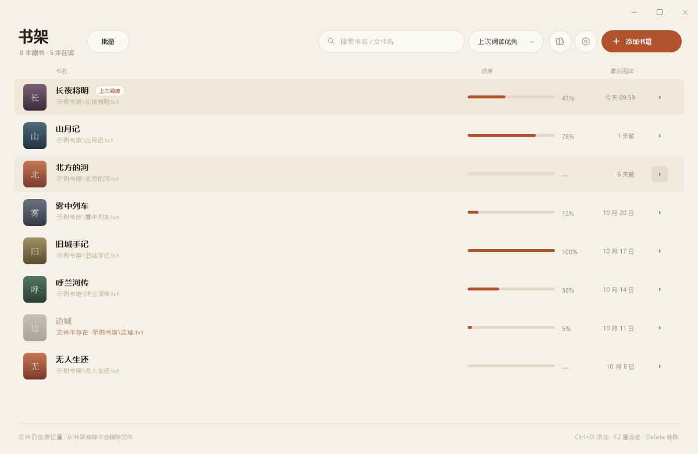
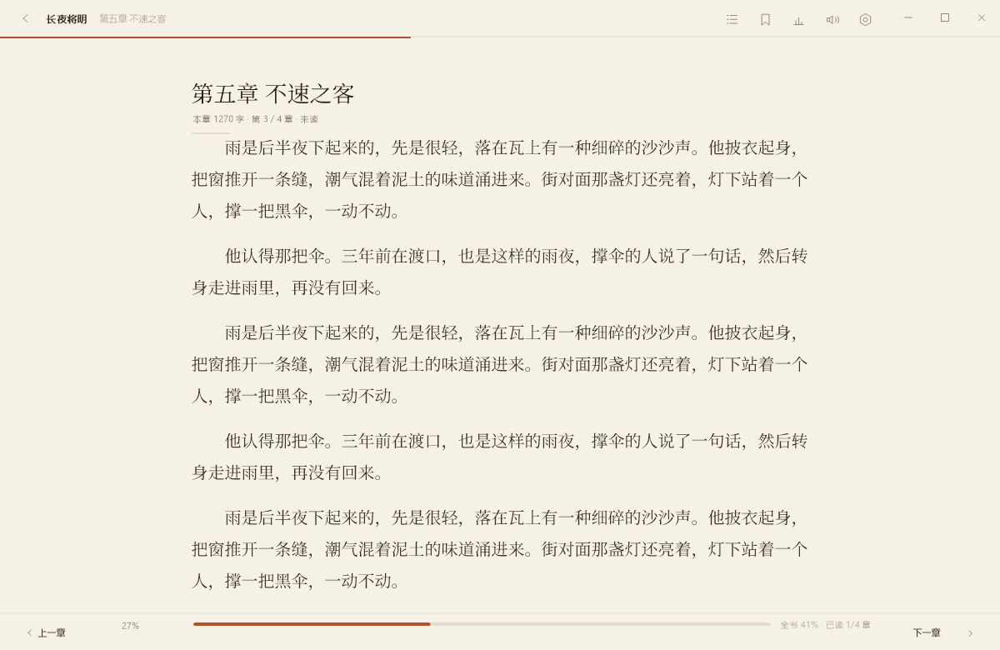

# 灯下 Lamplight

一个 Windows 上的轻量 TXT / EPUB 阅读器：**解压即用、单文件、本地优先**。
界面全部自绘，没有第三方 UI 框架；正文排版、目录、书签、阅读统计、朗读、在线书源都在一个 exe 里。

> **灵感来自 [binbyu/Reader](https://github.com/binbyu/Reader)**：那是一个很好用的 Windows 阅读器。
> 本项目是独立实现，并在书源格式上兼容它。

- 主程序约 260 KB，运行不需要安装任何运行时（Windows 10/11 自带 .NET Framework 4.8）
- 数据只有 `library.json` 和 `sources.json`，可以随程序目录一起拷走
- 不联网时不发任何请求



## 下载即用

到 [Releases](https://github.com/cccppy/lamplight/releases) 下载 **Lamplight-0.2.0-win.zip**，解压后双击 `Lamplight.exe` 即可。

```
Lamplight.exe          主程序
LamplightTts32.exe     朗读助手（必须和主程序放在同一目录）
使用说明.txt
```

要求：Windows 10 / 11。首次运行如果弹出 SmartScreen 提示，点「更多信息 → 仍要运行」。

## 功能

**阅读**

- 自动识别编码（UTF-8 / GB18030 / UTF-16），按章拆分，目录支持自定义正则
- 字号、行距、字距、段距、正文宽度、页边距、首行缩进可调
- 点击翻页（左右键 / 三区两种），滚轮连续滚动，章末继续滚自动进下一章
- 三种主题；支持自定义背景图片（铺满 / 平铺 / 居中 + 遮罩、纸面不透明度）
- 文本颜色自定义；窗口置顶、不透明度、托盘、无边框拖拽

**目录 / 书签 / 统计**

- 目录打开自动定位当前章，带未读 / 在读 / 已读状态点和章内进度
- 书签记录章节、章内百分比、上下文摘录，点击直接跳转，删除前确认
- 阅读统计按**已读章节 / 总章节**计算；在线书不虚报全书字数
- 书架支持批量选择、批量移出、批量删除本地文件

**朗读（TTS）**

- 系统 SAPI 语音，逐句高亮 + 自动滚动
- 语速、音量、定时停止；朗读浮条上的按钮可即时调整
- 停止可立即静音；句间预合成，减少停顿
- 附带 32 位语音助手：部分机器只装了 32 位语音，64 位进程无法直接使用

**在线书源**

- 兼容原版 Reader 的 `bs.json`（XPath 规则），也支持自定义 `sources.json`（正则规则）
- 支持 `{{key}}` 模板、POST 搜索、XPath 备选 `||`、GBK/UTF-8 自动识别
- 支持把「阅读（Legado）」格式书源**尽力转换**为本程序的 XPath 规则；含 JS / JSONPath 的规则会跳过
- 搜索结果按书名合并、按相关度排序、关键词高亮，可展开选择不同书源

**EPUB**

- 解析 `container.xml → OPF → spine`，按 spine 分章
- 正文提取为纯文本后走统一排版



## 与 Reader 的关系

**这个项目的灵感来自 [binbyu/Reader](https://github.com/binbyu/Reader)**：一个轻量、纯本地的 Windows 阅读器，交互和书源思路都很好。

本项目是**独立实现**：界面绘制、文本排版、位置锚定、朗读、书源引擎都是自行编写的，没有复制原版 Reader 的源代码。

参考的地方：

- 交互设计与功能取舍（目录 / 书签 / 阅读状态 / 自动翻页等）
- **书源格式兼容**：直接支持其 `bs.json`（XPath 字段），方便已有书源继续使用

书源解析、XPath 子集、HTML 解析、Legado 转换均为本项目自行实现。

## 使用

双击 `Lamplight.exe` 即可，数据文件在程序目录：

```
library.json   书架、进度、书签、阅读状态、统计、设置
sources.json   导入的书源
cache\         在线书源正文缓存
```

整个目录可以直接拷贝到 U 盘使用。更详细的说明见 [使用说明.txt](使用说明.txt)。

## 快捷键

| 键位 | 动作 |
| --- | --- |
| 空格 | 自动翻页 开/停 |
| ← / → | 上一页 / 下一页 |
| Ctrl + ← / → | 上一章 / 下一章 |
| Ctrl + F | 查找 |
| Ctrl + G | 按百分比跳转 |
| Ctrl + B | 添加书签 |
| B / T / I | 书签 / 目录 / 统计 |
| Ctrl + L | 回书架 |
| Ctrl + T | 窗口置顶 |
| Ctrl + Shift + T | 切换主题 |
| Ctrl + 滚轮 | 不透明度 |
| Ctrl + Shift + R | 朗读 / 停止 |
| F1 | 快捷键帮助 |
| F11 / F12 | 最大化 / 隐藏状态栏 |

以上键位都可以在「设置 → 快捷键」里逐项修改。

## 构建

需要 Windows + .NET Framework 4.x（系统自带，无需安装 SDK）：

```bat
build.bat
```

产物：

```
dist\Lamplight.exe        主程序
dist\LamplightTts32.exe   32 位朗读助手（必须和主程序放在一起）
```

## 书源

支持两类文件：

1. **原版 Reader 的 `bs.json`**：直接导入，使用其中的 XPath 规则
2. **「阅读」App 的书源 JSON**：导入时自动尝试转换（支持常见 CSS 写法，JS / JSONPath 跳过）

导入后可在「设置 → 书源」里查看、启用、删除。

## 已知限制

- 只支持 TXT / EPUB，不支持 PDF、MOBI
- Legado 书源只支持常见 CSS 写法；含 JS / JSONPath 的规则会跳过
- 第三方书源依赖站点结构，站点改版后会失效
- 朗读依赖系统语音；没有可用语音时会在界面提示

## 许可证

MIT，见 [LICENSE](LICENSE)。
